<!-- Automatically refreshed by .github/workflows/refresh-profile.yml. -->

  <picture>
    <source media="(max-width: 600px)" srcset="assets/solar-system-mobile.svg">
    
  </picture>

  <a href="https://github.com/devjysh">GitHub</a> ·
  <a href="https://github.com/devjysh/Rivet">Rivet</a>

